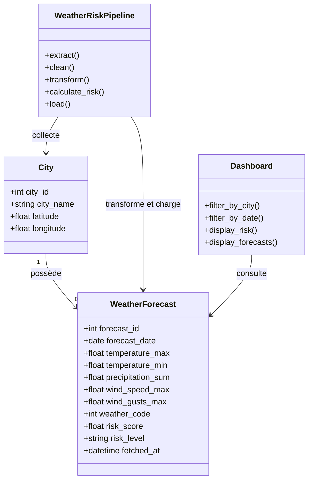

# MétéoRisk — Anticiper les perturbations logistiques au Maroc

## 1. Présentation du projet

**MétéoRisk** est un projet de Data Engineering qui vise à anticiper les perturbations météorologiques susceptibles d'affecter les opérations logistiques au Maroc.

Le système collecte les prévisions météorologiques des villes marocaines, transforme les données brutes en données structurées et calcule un **Weather Risk Score compris entre 0 et 100** afin d'identifier les villes et les périodes présentant les conditions météorologiques les plus défavorables.

Les données sont organisées selon une architecture **Medallion : Bronze → Silver → Gold**. Le pipeline utilise Apache Airflow pour automatiser les traitements, PostgreSQL pour stocker les données finales et Streamlit pour présenter les résultats dans un tableau de bord interactif.

### Objectifs métier

- Identifier les villes marocaines les plus exposées aux perturbations météorologiques.
- Anticiper les périodes de fortes précipitations, de vents violents ou de températures extrêmes.
- Comparer les risques entre plusieurs villes et plusieurs dates.
- Faciliter la planification des livraisons.
- Centraliser les prévisions dans une base de données structurée.
- Automatiser la collecte et le traitement des données.
- Fournir aux responsables logistiques un outil d'aide à la décision.

> **Important :** le Weather Risk Score est un indicateur opérationnel construit à partir des prévisions météorologiques. Il ne constitue pas une probabilité statistique de perturbation logistique, sauf si cette relation a été calibrée et validée sur des données historiques.

---

## 2. Technologies utilisées

| Technologie | Utilisation |
|---|---|
| Python | Développement du pipeline |
| Pandas | Nettoyage et transformation des données |
| Requests | Appels à l'API météorologique |
| SimpleMaps | Source des villes et de leurs coordonnées |
| Open-Meteo | Récupération des prévisions météorologiques |
| PostgreSQL | Stockage des données structurées |
| SQL | Analyse des données et requêtes métier |
| Streamlit | Développement du dashboard |
| Plotly | Visualisations interactives, si utilisé |
| Apache Airflow | Orchestration et planification des traitements |
| Docker | Conteneurisation des applications |
| Docker Compose | Orchestration des services |

---

## 3. Sources de données

### 3.1 SimpleMaps — Villes marocaines

Le fichier CSV des villes marocaines fournit les informations géographiques nécessaires à la collecte des prévisions météorologiques.

Les informations exploitées comprennent notamment :

- Le nom de la ville.
- Les coordonnées géographiques.
- Les informations de localisation disponibles dans le fichier source.

Les coordonnées de chaque ville sont utilisées pour interroger l'API Open-Meteo.

Source : [SimpleMaps — World Cities Database](https://simplemaps.com/data/world-cities)

### 3.2 Open-Meteo — Prévisions météorologiques

L'API Open-Meteo permet de récupérer les prévisions quotidiennes correspondant aux coordonnées géographiques de chaque ville.

Les variables utilisées comprennent :

- Température maximale.
- Température minimale.
- Quantité de précipitations.
- Probabilité de précipitations.
- Vitesse maximale du vent.
- Rafales maximales de vent.
- Code météorologique (`weather_code`).

Documentation officielle : [Open-Meteo Forecast API](https://open-meteo.com/en/docs)

Les données récupérées dépendent de la période de prévision disponible et des paramètres configurés dans l'API.

---

## 4. Architecture du projet

Le pipeline suit une architecture Bronze → Silver → Gold afin de séparer les données brutes, les données nettoyées et les données enrichies destinées à l'analyse métier.

```text
                    SOURCES DE DONNÉES
                  ┌────────────────────┐
                  │ SimpleMaps (CSV)   │
                  │ Open-Meteo API     │
                  └─────────┬──────────┘
                            │
                            ▼
                  ┌────────────────────┐
                  │   BRONZE LAYER     │
                  │ Données brutes     │
                  │ Conservées intactes│
                  └─────────┬──────────┘
                            │
                            ▼
                  ┌────────────────────┐
                  │   SILVER LAYER     │
                  │ Nettoyage          │
                  │ Validation         │
                  │ Jointure des données│
                  └─────────┬──────────┘
                            │
                            ▼
                  ┌────────────────────┐
                  │    GOLD LAYER      │
                  │ Feature Engineering│
                  │ Weather Risk Score │
                  └─────────┬──────────┘
                            │
                            ▼
                  ┌────────────────────┐
                  │    PostgreSQL      │
                  │ Données analytiques│
                  └─────────┬──────────┘
                            │
                 ┌──────────┴──────────┐
                 ▼                     ▼
        ┌─────────────────┐   ┌─────────────────┐
        │ Streamlit       │   │ SQL Analytics   │
        │ Dashboard       │   │ Requêtes métier │
        └─────────────────┘   └─────────────────┘

               Orchestration : Airflow
               Infrastructure : Docker Compose
```

### Organisation indicative du dépôt

```text
MeteoRisk/
│
├── data/
│   ├── bronze/
│   ├── silver/
│   └── gold/
│
├── extraction/
│   ├── cities_extractor.py
│   └── weather_extractor.py
│
├── transformation/
│   ├── clean_data.py
│   └── feature_engineering.py
│
├── load/
│   ├── database.py
│   └── load_gold.py
│
├── sql/
│   ├── schema.sql
│   └── analytics.sql
│
├── dashboard/
│   └── app.py
│
├── dags/
│   └── meteo_risk_dag.py
│
├── docs/
│   ├── uml/
│   └── screenshots/
│
├── tests/
│
├── requirements.txt
├── Dockerfile
├── docker-compose.yml
└── README.md
```

*Adaptez cette structure aux noms et chemins réellement présents dans votre dépôt.*

---

## 5. Étapes du pipeline de données

### Étape 1 — Extraction des données : Bronze

L'objectif de cette étape est de collecter les données sources tout en conservant une copie fidèle des réponses reçues.

Les traitements comprennent :

1. Télécharger le fichier CSV des villes marocaines.
2. Extraire les noms et les coordonnées des villes.
3. Interroger l'API Open-Meteo pour chaque ville.
4. Récupérer les prévisions quotidiennes pour la période souhaitée.
5. Stocker les réponses brutes dans le dossier `data/bronze/`.
6. Journaliser les erreurs et les appels échoués.

La collecte doit gérer les problèmes réseau, les timeouts, les erreurs HTTP et les réponses invalides.

Les fichiers Bronze doivent rester inchangés après leur création. Les nouvelles extractions sont conservées dans de nouveaux fichiers ou lots horodatés afin de préserver la traçabilité des données sources.

### Étape 2 — Nettoyage et validation : Silver

Cette étape transforme les données brutes en données propres, cohérentes et exploitables.

Les opérations comprennent :

- Normalisation des noms de colonnes.
- Conversion des dates vers un format cohérent.
- Conversion des températures, précipitations et vitesses de vent vers des types numériques appropriés.
- Détection des doublons.
- Contrôle des valeurs manquantes.
- Vérification des coordonnées géographiques.
- Validation des plages de valeurs attendues.
- Jointure entre les villes et leurs prévisions météorologiques.

Les données nettoyées sont stockées dans `data/silver/`.

Les anomalies doivent être identifiées et journalisées afin de faciliter le diagnostic des erreurs.

### Étape 3 — Feature Engineering et calcul du risque : Gold

La couche Gold contient les données enrichies destinées aux analyses et au dashboard.

Les nouvelles variables peuvent inclure :

| Feature | Description |
|---|---|
| `temperature_category` | Catégorie de température |
| `precipitation_category` | Catégorie de précipitations |
| `wind_category` | Catégorie de vent |
| `forecast_date` | Date de prévision |
| `risk_score` | Score de risque météorologique |
| `risk_level` | Niveau de risque associé au score |

Les seuils de catégorisation doivent être documentés et ajustés aux objectifs métier.

### Weather Risk Score

Le `risk_score` est compris entre 0 et 100. Il synthétise plusieurs facteurs météorologiques susceptibles de perturber les livraisons.

Une approche possible consiste à calculer un score pondéré :

\[
R = 100 \times (w_p P + w_w W + w_t T)
\]

Avec :

- \(P\) : indicateur normalisé de risque lié aux précipitations.
- \(W\) : indicateur normalisé de risque lié au vent.
- \(T\) : indicateur normalisé de risque lié aux températures extrêmes.
- \(w_p, w_w, w_t\) : poids associés aux différents facteurs, dont la somme vaut 1.

Les indicateurs sont normalisés entre 0 et 1 et les poids doivent être explicitement définis et justifiés.

Par exemple, une première configuration pourrait attribuer davantage de poids aux précipitations et au vent, selon les contraintes opérationnelles de l'entreprise.

Les seuils et les poids doivent être adaptés au contexte marocain et validés, si possible, à partir de données historiques de perturbations logistiques.

Exemple de niveaux de risque à titre indicatif :

| Score | Niveau | Interprétation opérationnelle |
|---:|---|---|
| 0–24 | Faible | Conditions généralement favorables |
| 25–49 | Modéré | Surveillance recommandée |
| 50–74 | Élevé | Préparation de mesures préventives |
| 75–100 | Très élevé | Évaluation opérationnelle prioritaire |

Ces seuils sont des choix de conception initiaux, et non des seuils météorologiques officiels.

Une fois calculées, les données Gold sont chargées dans PostgreSQL.

---

## 6. Modélisation de la base de données PostgreSQL

Le modèle de données sépare les informations géographiques des prévisions quotidiennes.

### Table `cities`

| Colonne | Description |
|---|---|
| `city_id` | Identifiant unique |
| `city_name` | Nom de la ville |
| `latitude` | Latitude |
| `longitude` | Longitude |

### Table `weather_forecasts`

| Colonne | Description |
|---|---|
| `forecast_id` | Identifiant de la prévision |
| `city_id` | Référence vers la ville |
| `forecast_date` | Date concernée |
| `temperature_max` | Température maximale |
| `temperature_min` | Température minimale |
| `precipitation_sum` | Quantité de précipitations |
| `precipitation_probability_max` | Probabilité maximale de précipitations |
| `wind_speed_max` | Vitesse maximale du vent |
| `wind_gusts_max` | Rafales maximales |
| `weather_code` | Code météorologique |
| `risk_score` | Score de risque |
| `risk_level` | Catégorie de risque |
| `fetched_at` | Date et heure de collecte |

Les types exacts doivent être adaptés aux données de l'API.

### Gestion des doublons et des mises à jour

Une contrainte d'unicité sur `(city_id, forecast_date)` permet d'éviter plusieurs lignes pour une même ville et une même date dans la table des prévisions courantes.

L'utilisation de `INSERT ... ON CONFLICT DO UPDATE` permet de mettre à jour une prévision existante lorsque l'API fournit de nouvelles valeurs.

Si l'historique des prévisions est nécessaire, il faut conserver les différentes versions dans une table distincte ou ajouter une clé de version incluant la date de collecte. Une mise à jour de la table courante ne suffit pas à préserver cet historique.

---

## 7. Analyse SQL

Les requêtes SQL permettent de répondre aux principales questions métier.

### Requête 1 — Villes ayant les températures maximales les plus élevées

```sql
SELECT
    c.city_name,
    MAX(w.temperature_max) AS max_temperature
FROM cities c
JOIN weather_forecasts w
    ON c.city_id = w.city_id
GROUP BY c.city_name
ORDER BY max_temperature DESC
LIMIT 10;
```

### Requête 2 — Villes présentant les plus fortes précipitations

```sql
SELECT
    c.city_name,
    MAX(w.precipitation_sum) AS max_precipitation
FROM cities c
JOIN weather_forecasts w
    ON c.city_id = w.city_id
GROUP BY c.city_name
ORDER BY max_precipitation DESC
LIMIT 10;
```

### Requête 3 — Villes présentant le risque moyen le plus élevé

```sql
SELECT
    c.city_name,
    ROUND(AVG(w.risk_score), 2) AS average_risk
FROM cities c
JOIN weather_forecasts w
    ON c.city_id = w.city_id
GROUP BY c.city_name
ORDER BY average_risk DESC;
```

### Requête 4 — Périodes présentant le risque maximal

```sql
SELECT
    forecast_date,
    MAX(risk_score) AS max_risk_score
FROM weather_forecasts
GROUP BY forecast_date
ORDER BY max_risk_score DESC;
```

### Requête 5 — Date la plus risquée pour chaque ville

```sql
SELECT
    city_name,
    forecast_date,
    risk_score
FROM (
    SELECT
        c.city_name,
        w.forecast_date,
        w.risk_score,
        ROW_NUMBER() OVER (
            PARTITION BY c.city_id
            ORDER BY w.risk_score DESC, w.forecast_date
        ) AS position
    FROM cities c
    JOIN weather_forecasts w
        ON c.city_id = w.city_id
) ranked
WHERE position = 1;
```

### Requête 6 — Indicateurs globaux du dashboard

```sql
SELECT
    COUNT(DISTINCT city_id) AS number_of_cities,
    MAX(temperature_max) AS highest_temperature,
    MAX(precipitation_sum) AS highest_precipitation,
    MAX(risk_score) AS highest_risk
FROM weather_forecasts;
```

Ces requêtes supposent que les noms de tables et de colonnes correspondent au schéma réellement créé dans PostgreSQL.

---

## 8. Dashboard Streamlit

Le dashboard fournit une vue synthétique et interactive des risques météorologiques dans les villes marocaines.

### Fonctionnalités

- Sélection d'une ou plusieurs villes.
- Filtrage par date ou période.
- Filtrage par niveau de risque.
- Consultation des prévisions météorologiques.
- Classement des villes selon leur score de risque.
- Visualisation des températures maximales et minimales.
- Analyse des précipitations et des vents.
- Identification des dates les plus risquées.
- Consultation des données détaillées issues de PostgreSQL.

### Visualisations possibles

- Indicateurs clés : nombre de villes, température maximale et risque maximal.
- Graphique en barres : score de risque par ville.
- Courbe temporelle : évolution du risque par date.
- Graphique des précipitations par ville.
- Tableau des prévisions avec mise en évidence des niveaux de risque.

Le dashboard lit les données depuis PostgreSQL afin de présenter les informations les plus récemment chargées par le pipeline.

---

## 9. Orchestration avec Apache Airflow

Apache Airflow automatise l'exécution du pipeline de données à travers un DAG.

### Workflow

```text
start
  |
  v
extract_cities
  |
  v
extract_weather
  |
  v
validate_bronze
  |
  v
transform_silver
  |
  v
build_gold_and_risk
  |
  v
load_postgresql
  |
  v
end
```

Les tâches principales sont :

1. Récupérer la liste des villes.
2. Extraire les prévisions météorologiques.
3. Vérifier la validité des données Bronze.
4. Nettoyer et transformer les données vers Silver.
5. Calculer les features et le score de risque dans Gold.
6. Charger ou mettre à jour les données dans PostgreSQL.

Le DAG peut être planifié pour une exécution quotidienne, avec plusieurs tentatives en cas d'échec et des délais entre les tentatives.

Les erreurs d'extraction, les données invalides et les erreurs de chargement doivent être journalisées. Des alertes peuvent être ajoutées pour signaler les échecs importants.

---

## 10. Installation et exécution

### Prérequis

- Git.
- Docker.
- Docker Compose.
- Accès à Internet pour récupérer les données sources.

### Étape 1 — Cloner le dépôt

```bash
git clone <URL_DU_DEPOT_GITHUB>
cd MeteoRisk
```

Remplacez `<URL_DU_DEPOT_GITHUB>` par l'adresse réelle de votre dépôt.

### Étape 2 — Configurer les variables d'environnement

Créez un fichier `.env` à partir du modèle fourni par le projet, par exemple `.env.example`.

Ce fichier peut contenir les paramètres de connexion PostgreSQL et les autres paramètres nécessaires aux services.

Ne publiez jamais les mots de passe ou les secrets dans le dépôt Git.

### Étape 3 — Construire et démarrer les services

```bash
docker compose up --build -d
```

Vérifiez les conteneurs :

```bash
docker compose ps
```

Consultez les journaux :

```bash
docker compose logs -f
```

Les services attendus sont PostgreSQL, Airflow et Streamlit, sous réserve de la configuration réelle de `docker-compose.yml`.

### Étape 4 — Accéder aux interfaces

Si les ports correspondants sont exposés :

| Service | Adresse locale |
|---|---|
| Dashboard Streamlit | http://localhost:8501 |
| Interface Airflow | http://localhost:8080 |
| PostgreSQL | localhost:5432 |

L'interface Airflow nécessite les identifiants configurés dans l'environnement du projet. PostgreSQL est généralement accessible via un client SQL plutôt que par une interface web.

### Étape 5 — Vérifier les données

Après une exécution réussie du DAG, vérifiez que les tables PostgreSQL contiennent les villes et les prévisions attendues.

Vous pouvez ensuite lancer le dashboard Streamlit pour consulter les indicateurs et les visualisations.

### Étape 6 — Arrêter les services

```bash
docker compose down
```

Pour supprimer également les volumes persistants, utilisez `docker compose down -v` uniquement si vous souhaitez réellement supprimer les données conservées par ces volumes.

---

## 11. Contrôles qualité et robustesse

La fiabilité du pipeline repose sur plusieurs contrôles :

- Vérification des réponses HTTP et du contenu JSON de l'API.
- Gestion des timeouts et des erreurs réseau.
- Validation des coordonnées et des dates.
- Détection des valeurs manquantes et incohérentes.
- Détection des doublons avant le chargement.
- Contrôle du nombre de villes et de prévisions récupérées.
- Chargement idempotent pour éviter les doublons lors des réexécutions.
- Journalisation des étapes et des erreurs.
- Conservation des données Bronze pour permettre le diagnostic et la reproductibilité.

Ces mécanismes facilitent la maintenance du pipeline et limitent les risques de données incomplètes ou incohérentes dans le dashboard.

---

## 12. Diagramme UML

Le diagramme de classes suivant présente une vue logique simplifiée des principales entités métier.



Ce diagramme décrit les concepts logiques du projet. Il doit être adapté à l'implémentation réelle si des tables d'historique, des journaux d'exécution ou des entités supplémentaires sont ajoutés.

---

## 13. Captures d'écran

Ajoutez des captures d'écran réelles dans `docs/screenshots/`.

### Dashboard général


### Comparaison des risques par ville


### Prévisions météorologiques


### DAG Airflow


Ces chemins sont des exemples. Les images doivent être présentes dans le dépôt pour s'afficher correctement sur GitHub.

---

## 14. Limites et perspectives d'amélioration

### Limites

- Les prévisions météorologiques peuvent évoluer après leur collecte.
- La disponibilité et l'horizon des prévisions dépendent de l'API utilisée.
- Le score de risque dépend des variables, des seuils et des pondérations choisis.
- Un risque météorologique élevé ne signifie pas automatiquement qu'une livraison sera retardée.
- La couverture des villes dépend de la qualité du fichier de référence.

### Perspectives d'amélioration

- Conserver l'historique des versions successives des prévisions.
- Ajouter une carte interactive des villes marocaines.
- Définir des seuils adaptés aux contraintes logistiques locales.
- Enrichir le score avec les historiques réels de retards et de perturbations.
- Ajouter des contrôles qualité automatisés.
- Mettre en place des alertes en cas d'échec du DAG.
- Optimiser les index et les requêtes PostgreSQL.
- Ajouter des tests automatisés et une pipeline CI/CD.

---

## 15. Auteur et contexte pédagogique

**Projet :** MétéoRisk — Anticiper les perturbations logistiques au Maroc  
**Formateur / référent :** Hamid OUFAKIR  
**Date de création du brief :** 11/09/2026  
**Période de réalisation prévue :** du 14/09/2026 au 18/09/2026  
**Formation / référentiel :** Certification RNCP Développeur·se en Intelligence Artificielle  
**Type de travail :** Individuel

**Dépôt GitHub :** À compléter  
**Lien Jira :** À compléter

---

## Conclusion

MétéoRisk met en œuvre un pipeline de Data Engineering destiné à transformer des prévisions météorologiques brutes en informations exploitables pour la prise de décision logistique.

Grâce à l'architecture Bronze → Silver → Gold, à PostgreSQL, aux requêtes SQL, à Streamlit et à l'orchestration par Airflow, le projet fournit une base structurée pour comparer les risques météorologiques entre les villes marocaines et anticiper les périodes nécessitant une attention opérationnelle particulière.
